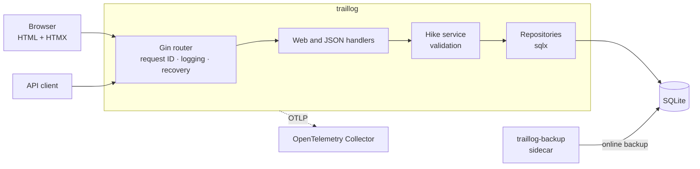

# TrailLog

[](https://github.com/maciejlistos/traillog-app/actions/workflows/ci.yaml)
[](LICENSE)

A small Go web application for logging hikes: routes, visits, tags, statistics, and GPX tracks on an interactive map. It runs in production on my [HomeLab platform](https://github.com/maciejlistos/homelab-platform).

I built it to practise application engineering the way I would want a service team to do it: tests at every layer, structured logs, traces and metrics from day one, a hardened container image, and a backup that has actually been restored.

## Features

- **Hikes:** create, edit and delete them, with search, filters, sorting and pagination.
- **Visits and tags:** a hike can be walked many times and carry many tags, using foreign keys, transactions and a many-to-many relationship.
- **GPX:** streaming XML import with limits on upload size, track points and text fields; distance and elevation calculations; export with round-trip tests.
- **Map:** an interactive route map with an elevation profile, using Leaflet. The tile server is configurable.
- **Statistics:** per-month and overall totals computed in SQL.
- **Interfaces:** server-rendered HTML with HTMX for progressive enhancement, plus a JSON API.

## Engineering

| Area | Implementation |
| --- | --- |
| Language and HTTP | Go, Gin, `html/template` with embedded templates |
| Storage | SQLite (pure-Go driver, no CGO), `sqlx`, versioned SQL migrations |
| Front end | Tailwind CSS and HTMX, built in a separate image stage; no JavaScript framework |
| Logging | `log/slog` JSON logs with request IDs, correlated with trace IDs |
| Telemetry | OpenTelemetry traces and metrics over OTLP, with custom spans in the service and repository layers |
| Health | Separate liveness (`/health/live`) and readiness (`/health/ready`, checks the database) endpoints, and `/version` with build metadata |
| Tests | Table-driven unit tests, HTTP handler tests and repository tests against real SQLite |
| Container | Multi-stage build; static binary; runs as non-root UID 65532; tests run during the build |
| Backup | `traillog-backup`: consistent online SQLite backups, integrity verification, restore and a scheduler, run as a sidecar |

## Architecture



Code layout:

```text
cmd/traillog/          HTTP server
cmd/traillog-backup/   backup, verify, check, restore and schedule commands
internal/hike/         domain: handlers, service, repositories, statistics, GPX tracks
internal/gpx/          GPX parsing, summaries and export
internal/database/     connection setup and migrations
internal/backup/       SQLite backup, verification and restore
internal/observability OpenTelemetry setup
internal/server/       router, health and version endpoints
internal/webui/        embedded templates and template functions
deploy/observability/  local Collector, Prometheus, Tempo and Grafana stack
```

## Running locally

Requirements: [mise](https://mise.jdx.dev/), Node.js for the CSS and JavaScript assets, and Docker for the optional observability stack.

```sh
mise install          # pinned Go toolchain
npm ci
mise run server       # builds assets, then serves on http://localhost:8080
mise run check        # gofmt, go vet, go test
```

Optional: run a local Collector, Prometheus, Tempo and Grafana stack to see traces and metrics.

```sh
mise run observability-up
```

Container image:

```sh
mise run container-build   # TRAILLOG_IMAGE=traillog:dev by default
mise run container-run
```

## Configuration

| Variable | Default | Purpose |
| --- | --- | --- |
| `TRAILLOG_ENVIRONMENT` | `development` | Environment name, used in logs and telemetry |
| `TRAILLOG_HTTP_ADDRESS` | `:8080` | Listen address, `:PORT` |
| `TRAILLOG_DATABASE_PATH` | `data/traillog.db` | SQLite database path |
| `TRAILLOG_LOG_LEVEL` | `info` | `debug`, `info`, `warn` or `error` |
| `TRAILLOG_LOG_FORMAT` | `text`; `json` when the environment is `production` | `text` or `json` |
| `TRAILLOG_GPX_MAX_UPLOAD_BYTES`, `TRAILLOG_GPX_MAX_TRACK_POINTS`, `TRAILLOG_GPX_MAX_TEXT_FIELD_BYTES` | safe limits | Limits for GPX uploads |
| `TRAILLOG_MAP_TILE_URL`, `TRAILLOG_MAP_ATTRIBUTION` | OpenStreetMap | Map tiles |
| `OTEL_EXPORTER_OTLP_ENDPOINT` and other standard `OTEL_*` variables | unset | OpenTelemetry export |

## Deployment

In the HomeLab, TrailLog runs as a single-replica StatefulSet on a Longhorn volume, with the backup sidecar writing to a separate volume, a namespace quota generated with KCL, and a tested restore Job. The manifests are in [homelab-platform/kubernetes/apps/traillog](https://github.com/maciejlistos/homelab-platform/tree/main/kubernetes/apps/traillog).

Backups are moving to a dedicated Kubernetes operator: sqlite-backup-operator (In progress).

## License

[Apache License 2.0](LICENSE).
